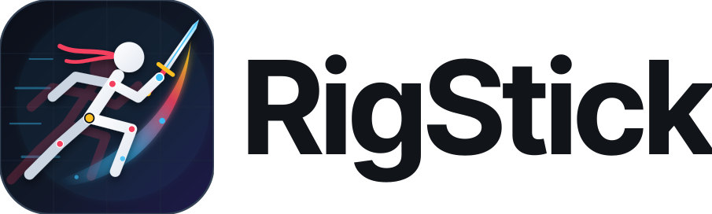

<p align="center">
  
</p>

<p align="center">
  A free, open-source stick figure animation app for Windows, Linux and the browser.<br>
  Also opens <code>.piv</code>, <code>.stk</code>, <code>.stknds</code> and <code>.nodes</code> files, and keeps your work on your device.
</p>

## Features

- **Connect any AI over MCP** (desktop): Claude, Gemini and other AI apps can read the animation, add and pose figures, apply moves, move the camera, render frames to check their work and read transcripts. Every AI change is one undo step. See [docs/AI.md](docs/AI.md).
- **Pen and Shape tools** (Build): click for corners, drag for smooth curves, click the first anchor to close and fill; drag rectangles, ellipses, polygons and stars. Every anchor is a joint, so drawings pose and animate like any figure.
- **Preset library** (drag and drop): 113 objects, 58 character moves, 51 motions, camera moves, 90 effects, 51 stickers, 25 text looks and 18 text animations. AI apps use the same presets, so they build scenes in a few calls.
- **3D Shot:** a three.js city with a physics-driven hero, rendered to video or built as editable layers.
- **Moves for beginners:** select a figure and press Walk, Run, Jump, Wave, Sit, Fall, Punch and more; one-click camera moves.
- **Transcribe voiceovers on device:** whisper.cpp (Windows) or Transformers.js (everywhere) downloads on first use; word timings, with live CPU, memory and GPU meters.

- **Pose stick figures** with fixed-length joints, IK for arms and legs, stretchy nodes and 3D figures with depth.
- **Build your own figures** from lines, circles, polygons, text and images, with a shared rig and per-part styles.
- **Two timelines:** a Simple, classic frame strip and an Advanced timeline with layers, folders, keys and easing.
- **Motion paths, onion skins and camera moves,** including camera follow.
- **Particle effects** (explosions, auras, beams, smoke) and brushes for drawing.
- **Export** MP4, WebM (with transparency), GIF, APNG, PNG/JPEG/SVG frames, and editable `.piv`/`.stk`.
- **27 interface languages**, light and dark themes, a touch interface for phones and tablets.

Everything (decoding, editing, saving and rendering) runs locally. Optional, consent-based diagnostics are described in [docs/telemetry.md](docs/telemetry.md).

## Get RigStick

**Windows:** download **RigStick-1.3.1-Setup-x64.exe** from [Releases](https://github.com/kaushalisreal/Rigstick/releases/latest) and run it. If SmartScreen warns you, click **More info**, then **Run anyway**. There is also a portable `.exe` that needs no install.

**From source** (Linux, or to change the code), you need [Git](https://git-scm.com/downloads), [Node.js 22+](https://nodejs.org) and [Python 3.11+](https://www.python.org/downloads/):

```sh
git clone https://github.com/kaushalisreal/Rigstick.git
cd RigStick
npm ci
python -m pip install -r backend/requirements-fast.txt
npm start
```

No Git? Use **Code → Download ZIP** on this page, unzip it, and run the last three commands inside the folder.
Projects save as `.rigs` files; RigStick also opens `.styk`, `.piv`, `.stk` and .nodes files.

## Build from source

Requirements: Node.js 22+ (CI uses 24.11) and Python 3.11+ (CI uses 3.12). Windows and Linux are tested on every change; macOS has an untested build target.

```sh
npm ci
python -m pip install -r backend/requirements-fast.txt
npm start            # desktop app (Electron)
npm run serve        # or the editor in your browser at http://127.0.0.1:47831
```

Set `RIGS_PYTHON` to choose a Python interpreter. Optional native helpers speed up large imports (`npm run build:frame-scan`); the Python fallbacks always work.

Packaging, on the matching operating system:

```sh
python -m pip install -r scripts/requirements-build.txt
npm run build:sidecar
npm run pack && npm run verify:package
npm run dist:win     # or dist:linux, dist:mac
```

The browser build: `npm run web:build`, then `npm run web:preview`. See [Web build](docs/WEB.md), [Linux](docs/LINUX.md) and [Touch interface](docs/TOUCH.md).

## Tests

```sh
npm run check        # syntax, stylesheet lint
npm test             # unit tests
python -m unittest discover -s backend -p "test_*.py"
```

Browser tests (`tests/*.browser.mjs`) run against `npm run serve` with Chrome or Playwright Chromium, for example `node tests/timeline.browser.mjs`. Some tests read a local corpus of .piv projects that is not distributed; they skip and name the missing file. [`.github/workflows/ci.yml`](.github/workflows/ci.yml) shows what runs on every pull request.

## How the code is organized

| Location | Responsibility |
| --- | --- |
| `src/editor*.mjs`, `src/pivot/` | Document model, commands, undo/redo, rigs, native evaluation and validation |
| `src/renderer*.mjs`, `src/prepared-frames.mjs` | WebGPU rendering, incremental edits, GPU playback packets |
| `src/playback*.mjs`, `src/document-transport.mjs` | Worker evaluation, playback caches, bounded document snapshots |
| `src/import-*.mjs`, `backend/`, `codecs/`, `native/` | .piv and .nodes decoding, the Python codec service, native helpers |
| `src/document-export*.mjs`, `src/image-*.mjs`, `src/video-export.mjs` | Saving, recovery and image/video export |
| `src/app.mjs`, `src/shell/`, `src/ui/`, `src/styles/` | Interface, workspaces, timelines and styles |
| `src/locales/`, `src/localization*.mjs` | Translations |
| `desktop/` | Electron main process, preload bridge, file access, updates |
| `web/` | Browser build: service worker and Cloudflare configuration |
| `tests/`, `scripts/` | Tests, smoke tests, benchmarks, build and release scripts |
| `docs/` | Feature contracts and architecture |

Start with [docs/ARCHITECTURE.md](docs/ARCHITECTURE.md). Feature behavior is documented in `docs/`, for example [the timeline](docs/TIMELINE.md), [scene editing](docs/SCENE-EDITING.md) and [the renderer](docs/renderer.md).

## Contributing

Bug reports, ideas, translations and pull requests are welcome. Read [CONTRIBUTING.md](CONTRIBUTING.md) first, and follow the [Code of Conduct](CODE_OF_CONDUCT.md). Report security problems privately as described in [SECURITY.md](SECURITY.md).

## License

RigStick is free software: you can redistribute it and/or modify it under the terms of the [GNU General Public License](LICENSE), version 3 or (at your option) any later version. Bundled third-party components keep their own licenses; see [THIRD_PARTY_NOTICES.md](THIRD_PARTY_NOTICES.md).
